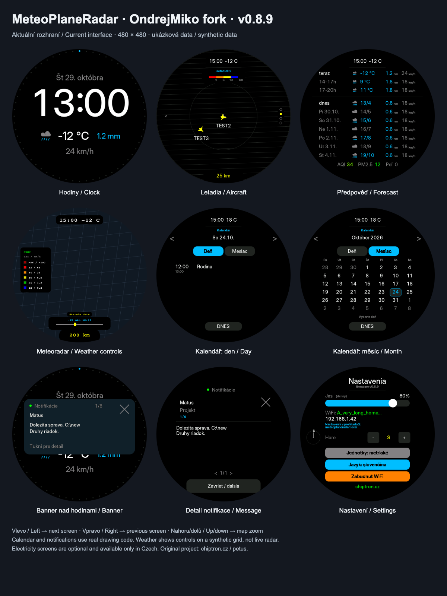

# MeteoPlaneRadar — OndrejMiko fork

Hodiny, letadla, meteoradar, předpověď, kalendář a notifikace na kulatém dotykovém
panelu Waveshare ESP32-S3. Nastavení probíhá z prohlížeče.

**Vývojová verze 0.8.10** · [Firmware ke stažení](https://github.com/OndrejMiko/MeteoPlaneRadar/releases/latest)
· [English](README_EN.md) · [Changelog](CHANGELOG.md)

**Google Chat most:** [Windows aplikace](tools/google-chat-windows/README.md) ·
[macOS aplikace](tools/google-chat-macos/README.md). Obě podporují kód z displeje
a přihlášení Googlu v prohlížeči. Zdrojová verze ve větvi `main` může být novější než poslední vydaný firmware.

Toto je fork [petus/MeteoPlaneRadar](https://github.com/petus/MeteoPlaneRadar),
původního projektu **[chiptron.cz](https://chiptron.cz)**. Zachovává jeho historii
a funkce do integrované verze 0.8.5 a přidává vlastní ovládání a rozhraní.
Autora původního projektu lze podpořit na [Buy Me a Coffee](https://buymeacoffee.com/chiptroncz).



Náhledy jsou vykreslené skutečným kódem s ukázkovými daty, nejsou fotografiemi
zařízení. Meteoradar ukazuje ovládací vrstvu nad testovacím podkladem, nikoli živé srážky.

## Co je v tomto forku jinak

- **Ovládání:** vlevo další obrazovka, vpravo předchozí; nahoru/dolů na mapách zoom.
  Dlouhý stisk levé/pravé poloviny dál funguje. Body obrazovek mizí po 5 s,
  body zoomu vpravo po 10 s, dosah zůstává dole na černém pozadí.
- **Vzhled:** vzdušnější hodiny, kompaktní černé podklady údajů na mapách,
  odsazené legendy, čas animace a tenký posuvný pásek dole na meteoradaru.
  Detail letadla používá stejné okno a velký křížek jako notifikace.
- **Kalendář:** denní a měsíční pohled, až tři Google/iCloud/jiné ICS odběry,
  podpora běžných časových pásem včetně iCloud VTIMEZONE. Barevné tečky a názvy
  zdrojů se ukazují jen při více aktivních kalendářích.
- **Notifikace:** banner nad libovolnou obrazovkou, detail a fronta zpráv.
  Velký křížek má neviditelnou aktivní plochu 64 × 64 px. První službou je
  Google Chat přes [macOS aplikaci v horní liště](tools/google-chat-macos/README.md)
  nebo [Windows aplikaci u hodin](tools/google-chat-windows/README.md),
  s párováním krátkým kódem a přihlášením přes prohlížeč.
- **Web a jazyky:** devět záložek, pevné ukládání vpravo nahoře,
  čeština/angličtina/slovenština; vyhlazené fonty se slovenskou diakritikou.
- **Elektřina:** cena a výrobní mix jsou volitelné **jen při češtině**.
  V SK/EN zmizí z nabídky i nastavení a nestahují data; konfigurace se zachová.
  Sledování limitů Claude bylo z firmwaru i mostu odstraněno.
- **Zachované novinky autora:** tři WiFi sítě, Inter/Poppins/Inter thin,
  typové ikony letadel, ČHMÚ masked, hlídání bouřek a letadel, výhled z okna,
  výškové barvy a Home Assistant.

Úplná historie změn je v [CHANGELOG.md](CHANGELOG.md).

## Co to umí

| Obrazovka | Co ukazuje | Zdroj |
| --- | --- | --- |
| **Hodiny** | čas, datum, počasí, vteřinový prstenec | Open-Meteo |
| **Letadla** | letadla v okolí s ikonou podle typu, detail letu včetně trasy | adsb.fi, adsb.lol |
| **Meteoradar** | animovaná srážková situace | ČHMÚ, ČHMÚ masked nebo RainViewer |
| **Předpověď** | nyní, +3 h, +6 h, dnes, zítra, pozítří a další dny, ovzduší a pyl | Open-Meteo |
| **Kalendář** | denní agenda, měsíční přehled, až tři odběry | Google/iCloud/jiné ICS |
| **Cena elektřiny (CZ)** | čtvrthodinové ceny dnes/zítra, příplatek a DPH | spotovaelektrina.cz / OTE |
| **Výroba elektřiny (CZ)** | výrobní mix, OZE, spotřeba a přeshraniční bilance | Energy-Charts / ENTSO-E |
| **Nastavení** | jas, orientace mapy, jednotky, jazyk | — |

Všech sedm datových obrazovek lze vypnout; elektřina je dostupná pouze v češtině.
Nastavení je dostupné vždy. Kalendář ani elektřina se při prvním přidání do firmwaru samy nezapnou;
běžné aktualizace zachovávají jejich uložené volby. Rozhraní je
česky, anglicky nebo slovensky. Jazyk zvolíte v horní části webového nastavení
nebo tlačítkem Jazyk na displeji (cyklus čeština → angličtina → slovenština).
V prohlížeči výběr změní jazyk stránky; pro uložení do zařízení přejděte na
**Obrazovky → Uložit**. Volba se zachová po restartu. Vyhlazené fonty podporují
českou i slovenskou diakritiku; původní pixelové písmo používá text bez diakritiky.

## Kalendář

Na kartě **Kalendář** ve webu zadejte název, barvu a ICS odkaz až tří kalendářů.
Google: Nastavení → Integrovat kalendář → Tajná adresa ve formátu iCal.
iCloud: Veřejný kalendář → Kopírovat odkaz (`webcal://` se převede na HTTPS).
Kdokoli s iCloud odkazem může kalendář číst. Používá se pouze odběr pro zobrazení,
bez přihlášení OAuth/CalDAV a bez vytváření či úprav událostí.

Na kartě **Kalendář** klikněte vpravo nahoře na **Uložit a zapnout kalendář**.
Kalendář lze také zapnout nebo vypnout na kartě **Obrazovky**.
Je-li nastaveno heslo správce, vyplňte jej před uložením na kartě Systém.
Odkazy se nevracejí na web ani do exportu; prázdné pole ponechá uložený odkaz,
zaškrtnutí „Smazat uložený odkaz“ ho odstraní. Po obnově zálohy do nového zařízení
odkazy zadejte znovu. Názvy, barvy a ostatní nastavení se zálohují.

Podporované definice časových pásem `VTIMEZONE` se čtou přímo z odběru:
standardní/letní čas, běžné roční přechody a explicitní data změn. Limity jsou
8 pásem a 512 přechodů na pásmo. Historie pásem může začínat rokem 1600,
události zůstávají v rozsahu 1900–2100; složitější definice zůstanou
odmítnuté. Webový stav ukáže konkrétní `TZID`, není potřeba sdílet soukromý odkaz.
Paměťový rozpočet kalendáře je přibližně 746 kB PSRAM.

Na kartě **Kalendář** použijte **Uložit a zapnout kalendář**. Uložený odkaz sám
o sobě nezapíná obrazovku; její stav ukazuje tato karta. Máte-li adresu již uloženou,
není nutné ji zadávat znovu. Při zapnutí se zařízení může restartovat.

Na displeji přepínáte **Den/Měsíc**. Šipky listují, datum v měsíci otevře
agendu, **DNES** vrátí dnešní datum. Více než tři události se stránkují klepnutím
na agendu. Jeden aktivní kalendář nemá barevné tečky ani popisky zdroje; při více
kalendářích jsou odlišeny barvou a názvem.

Cache zabírá přibližně **0,71 MiB PSRAM**, nevytváří další framebuffer a má pevné
limity: předchozí, aktuální a dva příští měsíce, 256 výskytů a 512 KiB ICS na zdroj.
Obnovování je nastavitelné po 5–1440 minutách; chyby se zkouší znovu po dvou minutách.
Při chybě zůstanou poslední platná data s upozorněním. Stav a přidělená PSRAM jsou
vidět ve webu. Vypnutý kalendář nestahuje data a uvolní pracovní buffery.

Podporováno je UTC, místní čas zařízení a běžná středoevropská pásma (např.
Europe/Bratislava, Europe/Prague). Parser podporuje běžné denní, týdenní, měsíční
(včetně `1MO` / `-1FR`) a roční opakování, intervaly, COUNT/UNTIL, EXDATE/RDATE,
přesuny a rušení jednotlivých výskytů. Složitější pravidla a pásma bez podporované definice jsou
hlášena jako chyba; úplná implementace RFC 5545 to není. Přesný seznam je v kódu
`CalendarIcs.cpp`. Tato verze byla ověřena sestavením a host testy, náhledy nejsou důkazem ověření všech gest a služeb na fyzickém zařízení.

## Notifikace a Google Chat

Ve webu otevřete **Notifikace**, nastavte zobrazení a použijte **Uložit a zobrazit test**.
Pro Mac zvolte **Zobrazit párovací kód** a zadejte jej v aplikaci Meteo Chat spolu
s adresou displeje. Pro Windows použijte [Windows most](tools/google-chat-windows/README.md)
s totožným párováním a ikonou u hodin. Kód je jednorázový a platí dvě minuty. Účet přihlásíte tlačítkem
**Prihlásiť cez Google** v aplikaci, vyberete chaty a zapnete most. Počítač musí běžet.
Jednorázová konfigurace Google OAuth při vlastním sestavení aplikace je popsána
v [kompletním návodu](tools/google-chat-macos/OAUTH_SETUP.sk.md); hotový build
uživatele nevyžaduje import registračního JSON. Starší Python most zůstává jako
[volitelná alternativa](tools/google-chat-bridge/README.md).

Banner jde klepnutím rozbalit. **Křížek** zprávu zavře jen na displeji, neposílá
odpověď ani potvrzení přečtení do Chatu. Po vypršení banneru zůstane zpráva pod
odznakem s počtem; detail zůstává otevřený do zavření. Notifikace mají přednost
před gesty obrazovky i automatickou ukázkou letadla.

## Elektřina pouze v češtině

V češtině otevřete **Obrazovky**, zapněte **Cenu elektřiny** a/nebo **Výrobu elektřiny**
a uložte. Ve stejné záložce nastavíte příplatek v Kč/MWh, DPH a dvoupísmenný kód
země výrobního mixu (např. `cz`, `sk`, `de`). Nula u příplatku i DPH znamená čistou
burzovní cenu; nejde o celkovou cenu vyúčtování ani o přihlášení k účtu ČEZ.
Původní geografická omezení zdrojů zůstávají: cena pro oblast českého trhu, mix pro Evropu.

Přepnutí na angličtinu nebo slovenštinu skryje obě obrazovky z webového menu,
nastavení, gest i automatického střídání a zastaví jejich stahování. Uložené
volby a tarif se neztratí; po návratu k češtině jsou opět dostupné.

## Hardware

**Waveshare ESP32-S3-Touch-LCD-2.1** nebo **ESP32-S3-Touch-LCD-2.8C** —
ESP32-S3R8 (8 MB PSRAM, 16 MB flash), kulatý displej 480×480 s řadičem ST7701,
expandér TCA9554. Dotyk je CST820 (2.1), respektive GT911 (2.8C).
Stačí deska a USB-C kabel, nic se nepájí.

Obě desky jsou pinově totožné a **jedna binárka běží na obou** — firmware se při
startu zeptá dotykového řadiče, kdo je, a podle toho zvolí inicializaci panelu
i časování. Na kterou desku se rozhodl, ukazuje sériový výpis při startu a
stavová tabulka na webu. Kdyby to na vaší desce určilo špatně (typicky vadný
dotykový řadič), dá se to napevno vnutit přes `BOARD_FORCE` v `Config.h`.

---

## První zapnutí

1. Nahrajte firmware (viz níže) a zapněte desku.
2. Připojte se k otevřené síti **`MeteoPlaneRadar`** — na displeji je QR kód.
3. Otevřete `http://192.168.4.1/`, vyberte svou WiFi a uložte.

Přístupový bod zůstane aktivní, dokud síť nezadáte. Potom najdete nastavení na
**`http://meteoplaneradar.local/`** nebo na IP adrese, která je vypsaná na
obrazovce Nastavení.

Hodiny mají jen malé černé pozadí podle šířky textu, údaje o letadlech
kompaktní vlastní panel. Meteoradar ukazuje čas snímku a tenký posuvný indikátor
animace dole nad dosahem; velký horní výřez mapu nezakrývá. Ikony letadel a mapové popisky udržují kolem těchto údajů odstup,
aby byly čitelné i při hustém provozu nebo barevných srážkách.

## Nastavení v prohlížeči

Web běží trvale. Nastavíte v něm polohu (i vyhledáním města), které obrazovky
zobrazovat a jestli se mají střídat, zdroj meteoradaru, jazyk, denní a noční
jas, vzhled hodin, filtry letadel a upozornění na nouzové squawky. Je tam i
dálkové ovládání (přepínání obrazovek a rozsahu bez dotyku displeje), stavová
stránka, export a import nastavení a aktualizace firmwaru.

Většina položek se **ukládá hned po změně**. Pevná horní lišta vpravo nabízí
uložení polohy, obrazovek, kalendářů, notifikací a systémových změn. Na kartách
Vzhled a Letadla ukazuje průběžné ukládání. Změny polohy, obrazovek a zdroje
meteoradaru vyžadují restart zařízení. Sekce se přepínají podtrženými záložkami;
na mobilu lze jejich řádek posouvat vodorovně.

### Heslo

Heslo je **nepovinné a ve výchozím stavu žádné není** — aktualizace firmwaru,
import nastavení i tovární reset jsou hned po nahrání přístupné komukoli, kdo se
dostane na adresu zařízení. Nastavíte ho v záložce Systém: pole *Současné heslo*
necháte poprvé prázdné a vyplníte jen *Nové heslo*. Jedna mezera v Novém hesle
ochranu zase zruší. Uživatelské jméno na stránce `/update` je `admin`.

Heslo se **ukládá v čitelné podobě**. Aktualizační stránka používá HTTP Basic a
knihovně se musí předat skutečné heslo, takže otisk tam použít nelze — hashovat
kopii v NVS, když vedle leží totéž otevřeně, by bylo jen divadlo. Chrání to před
domácností, ne před někým, kdo si přečte flash nebo odposlouchává síť.

**Zapomenuté heslo** jde zrušit jedině podržením tlačítka **BOOT při startu
(~3 s)**. To provede tovární reset, takže smaže i WiFi a všechna ostatní
nastavení.

## Ovládání

| Gesto | Akce |
| --- | --- |
| **Přejetí vlevo** | následující zapnutá obrazovka |
| **Přejetí vpravo** | předchozí zapnutá obrazovka |
| **Přejetí nahoru na mapě** | přiblížení mapy |
| **Přejetí dolů na mapě** | oddálení mapy |
| **Krátké klepnutí na letadlo** | otevření detailu a trasy |
| **Klepnutí na hodiny** | den/noc, pouze když je automatický noční režim vypnutý |
| **Kalendář: Den/Měsíc, šipky, datum, DNES** | přepnutí pohledu, listování a návrat na dnešek; více událostí klepnutím stránkujete |
| **Cena elektřiny (CZ): nahoru/dolů nebo střed** | dnes/zítra, pokud jsou zítřejší ceny dostupné; klepnutí na prstenec vybere čtvrthodinu |
| **Klepnutí na banner / odznak notifikací** | otevření detailu; křížek zprávu zavře |
| **Křížek v detailu letadla** | zavření detailu; neviditelná aktivní plocha 64 × 64 px, klepnutí do obsahu jej nezavře |
| **Dlouhý stisk vlevo / vpravo** | předchozí / následující obrazovka |
| **BOOT při startu (~3 s)** | tovární reset |

Body obrazovek nahoře se zobrazí po přepnutí na 5 sekund. Ukazatel rozsahu
vpravo na mapě se zobrazí při vstupu a při změně zoomu na 10 sekund. Údaj
v kilometrech zůstává dole, na původním místě bodů rozsahu. Zoom na krajních
hodnotách nepřeskakuje na opačný konec. Kalendářem se listuje jeho šipkami;
vodorovný swipe v něm nadále přepíná celou obrazovku. Při otevřeném detailu
letadla swipe nebo dlouhý stisk nejprve zavře detail. Otevřená notifikace gesta zachytí.
Ruční přepnutí pozastaví automatické střídání na trojnásobek intervalu
(nejméně 30 s, nejvýše 10 min). Nastavení se automaticky neopouští.

Na obrazovce Nastavení se řádkem `Nahore` volí, **který světový směr je nahoře**
na radaru letadel — tedy směr, kterým se díváte z okna. Meteoradar se záměrně
neotáčí.

## Meteoradar: ČHMÚ, ČHMÚ masked nebo RainViewer

**ČHMÚ** je ostřejší, ale pokrývá jen ČR a okolí — s polohou v zahraničí zůstane
obrazovka prázdná. Ukazuje všechno, co radary vidí, plnou barvou.

**ČHMÚ masked** je tentýž snímek, ale ČHMÚ ho porovná s měřením ve výšce 2 km:
plnou barvou jsou jen místa, kde srážky opravdu dopadají na zem, zbytek
(srážky, které se cestou vypaří, kovadliny vzdálených bouřek) je bledší. Na
otázku „bude u nás pršet?“ odpovídá přesněji, pro sledování bouřek je lepší
plný ČHMÚ. **RainViewer** pokrývá Evropu i svět. Jeho dlaždice končí na
zoomu 7, takže bližší rozsahy se skládají ze zoomu 7 zvětšeného mocninou dvojky;
obraz je hrubší, ale víc detailu RainViewer nemá. Stahuje se postupně — nejdřív
nejnovější snímek, animace se dotáhne na pozadí. Legenda se přepíná spolu se
zdrojem, protože každý má vlastní paletu.

## Střídání obrazovek: bouřka a letadlo poblíž

Dvě volby na záložce Obrazovky dělají ze střídání něco chytřejšího:

- **Meteoradar jen při bouřce** — meteoradar se do střídání přidá, jen když je
  do zadané vzdálenosti (výchozí 50 km) odraz aspoň zadané síly (výchozí
  20 dBZ). Kontroluje se každých 5 minut nejnovější snímek ČHMÚ. Po dvou
  klidných snímcích meteoradar zase vypadne. Funguje i s jinak vypnutou
  obrazovkou Meteoradar.
- **Letadla jen když je letadlo poblíž** — obrazovka Letadla se sama nestřídá,
  ale když se letadlo přiblíží na zadanou vzdálenost (výchozí 5 km), ukáže se
  na zadanou dobu (výchozí 15 s) i s otevřeným detailem a pak se pokračuje tam,
  kde se skončilo. Každé letadlo jednou za 15 minut.

**Výhled z okna** (záložka Letadla): směr okna, šířka výhledu a dohled.
Letadlo ve výhledu má při upozornění přednost před bližším letadlem, které
z okna vidět není. Výseč se zakreslí do radaru letadel.

Všechny tyto limity se ukládají, přežijí restart a jsou v exportu i importu
nastavení.

## Více WiFi sítí

Zařízení si pamatuje až **tři sítě**. Zapisují se v záložce Ovládání a jdou
zadat i když síť zrovna není v dosahu. Při startu se zkusí nejsilnější
dosažitelná, po výpadku spojení se po minutě projdou ostatní.

## Home Assistant

> **⚠ Tato funkce nebyla vyzkoušena se skutečným Home Assistantem.** Formát
> odpovídá dokumentaci integrace RESTful, ale ověřený zatím není. Pokud něco
> nesedí, dejte vědět.

Zařízení umí Home Assistantu nabídnout svá data. Funguje to opačně, než by se
čekalo: **Home Assistant si data sám stahuje** z adresy

```
http://meteoplaneradar.local/api/ha
```

(nebo z IP adresy zařízení). Nepotřebujete MQTT, broker ani doplněk — stačí
integrace **RESTful**, která je v Home Assistantu vestavěná. Postup:

1. Ve webovém nastavení zařízení na záložce **Home Assistant** zaškrtněte
   *Zpřístupnit data pro Home Assistant*.
2. Zkopírujte z té záložky připravený blok a vložte ho do
   `configuration.yaml` v Home Assistantu.
3. Restartujte Home Assistant. Objeví se senzory `MPR Teplota`, `MPR Bourka`,
   `MPR Nejblizsi letadlo` a další.

Odpověď vypadá takhle (zkráceno):

```json
{
  "temperature": 12.4, "wind_kmh": 14, "precip_mm": 0, "weather_code": 3,
  "today_min": 6.1, "today_max": 14.8, "sunrise": "06:41", "sunset": "16:52",
  "screen": "clock",
  "storm": { "active": false, "max_dbz": 16, "nearest_km": null, "frame": "10:05" },
  "aircraft": { "count": 3, "alert": false, "callsign": "CSA1234", "type": "A20N",
                "kind": "narrow-body", "distance_km": 4.2, "altitude_m": 3200,
                "in_window": true }
}
```

Data jsou jen ke čtení a bez hesla — neříkají nic, co by nebylo vidět na
displeji. Dokud je funkce zapnutá, zařízení hlídá bouřku (jeden snímek ČHMÚ
za 5 minut) a letadla poblíž (malý dotaz jednou za 30 s), aby čísla byla živá.

Proč ne MQTT: potřebovalo by broker v síti, další knihovnu a nastavování
přihlašovacích údajů. REST stačí na čtení a jde nastavit jen vložením textu.
Kdyby se ukázalo, že je potřeba i ovládání z Home Assistantu, existující
adresy `/api/screen` a `/api/range` jde volat přes `rest_command`.

## Hodiny bez NTP

Čas se bere z hlavičky `Date` odpovědí, které zařízení stahuje tak jako tak.
Neprochází UDP portem 123, nedá se zvlášť zablokovat a nečeká se na něj při
startu. Časové pásmo se určuje podle polohy; `TZ_INFO` v `Config.h` je záložní hodnota.

---

## Nahrání firmwaru

**Přes USB** (první nahrání a záchrana): stáhněte `*.merged.bin` z [Releases tohoto forku](https://github.com/OndrejMiko/MeteoPlaneRadar/releases/latest),
připojte desku do konektoru **USB** a nahrajte na
[esp32flasher.chiptron.cz](https://esp32flasher.chiptron.cz) v Chrome nebo Edge.

**Přes WiFi**: stáhněte `*.ino.bin` (bez `merged`) a nahrajte na
`http://meteoplaneradar.local/update`. Displej během zápisu zhasne — RGB panel
čte obraz z PSRAM a zápis do flash mu data odřezává. Po dokončení se rozsvítí.

Pro tento fork vždy vyberte jeho vlastní binárku; výchozí obraz ve flasheru
může patřit původnímu projektu. Sloučený USB obraz se zapisuje od adresy `0x0`.
Kalendáře, WiFi i nastavení běžná OTA aktualizace zachovává; tovární reset je smaže.

---

## Pro vývojáře

Ověřený reprodukovatelný build používá profil v `MeteoPlaneRadar/sketch.yaml`:
**ESP32 core 3.0.7**, **GFX Library for Arduino 1.4.9**, **PNGdec 1.0.1** a
**ArduinoJson 7.1.0**. QRCode je přibalen; `WebServer`, `DNSServer`, `ESPmDNS`,
`Update` a `Preferences` jsou v core. WiFiManager ani ElegantOTA se nepoužívají.

Nastavení IDE: ESP32S3 Dev Module, **PSRAM: OPI**, Flash 16 MB QIO,
**Partition Scheme: Custom** (`partitions.csv`, dvě aplikační oblasti pro OTA),
USB CDC On Boot: Enabled. Nebo `arduino-cli compile --profile default MeteoPlaneRadar`.

```
MeteoPlaneRadar.ino   správce obrazovek, dotyk, hlavní smyčka
Config.h              laditelné konstanty
Settings.*            nastavení v NVS + JSON pro web
Lang.*                české, anglické a slovenské řetězce
Layout.*              pásy obrazovky a hlídání kolizí
WebConfig.* WebPage.h webový server, API, portál, OTA
Net.*                 sdílené HTTPS stahování
Calendar.* CalendarIcs.* ICS odběry, omezená PSRAM cache, parser
Notifications.* NotificationPairing.* globální zprávy a párování mostu
Navigation.*          dočasné indikátory obrazovek a zoomu
ScreenChrome.*        čitelné podklady a časová osa meteoradaru
Energy.*              cena a výrobní mix, jen CZ
Forecast.*            Open-Meteo: předpověď, slunce, ovzduší
RainViewer.*          dlaždicový radar
StormWatch.*          hlídání bouřky ze snímku ČHMÚ (0.8.0)
PlaneWatch.*          hlídání letadel poblíž a výhledu z okna (0.8.0)
PlaneIcon.*           ikony letadel podle typu (0.8.0)
AAFont.* ClockFonts.h vyhlazené písmo hodin (0.8.0)
Screen*.{h,cpp}       jednotlivé obrazovky
tools/extend_slovak_fonts.py doplnění slovenských znaků do bitmap
tools/google-chat-macos/ nativní most pro macOS
tools/google-chat-windows/ Windows aplikace u hodin, .NET 10
tools/render_screenshots.cjs náhledy z testovacích SVG
```

**Proč se prvky nepřekrývají:** obrazovka si své pásy zabere dřív, než se kreslí
mapa. Cokoli umístěného podle dat (popisky měst, callsigny) si pak musí místo
vyžádat, a když je zabrané, nekreslí se vůbec. Konstanty `LY_*` v `Layout.h`
drží stejné prvky na stejných řádcích napříč obrazovkami.

Sériový výpis 115200 Bd přes konektor **USB**. Totéž bez kabelu je na stavové
stránce webu.

---

## Zdroje dat

Jen pro osobní nekomerční použití — respektujte podmínky poskytovatelů.

**Letadla, registrace a typ:** [adsb.fi](https://adsb.fi) · **trasy:** [adsb.lol](https://adsb.lol) ·
**srážky ČR:** [ČHMÚ](https://opendata.chmi.cz) ·
**srážky svět:** [RainViewer](https://www.rainviewer.com) ·
**počasí, ovzduší, geokódování:** [Open-Meteo](https://open-meteo.com) ·
**poloha podle IP:** [ip-api.com](http://ip-api.com) ·
**mapa:** hranice Natural Earth (public domain), města [GeoNames](https://www.geonames.org) (CC BY 4.0) ·
**cena elektřiny (CZ):** [spotovaelektrina.cz](https://spotovaelektrina.cz) / OTE ·
**výrobní mix:** [Energy-Charts](https://energy-charts.info) / Fraunhofer ISE / ENTSO-E ·
**čas:** hlavička `Date` (bez NTP) ·
**rozdělení ikon letadel:** [ADS-B Radar](https://adsb-radar.com/help/icons.html)

## Přispěvatelé

- **[Pájeníčko.cz](https://pajenicko.cz)**
  - **Podpora desky Waveshare ESP32-S3-Touch-LCD-2.8C.** Deska se pozná při
    startu podle dotykového řadiče, takže jedna binárka běží na 2.1 i na 2.8C
    a nikdo nemusí vybírat, který soubor nahrát.
  - **Legendu na meteoradaru jde skrýt** — přepínač ve webovém nastavení.

## Z čeho projekt vychází

- [ok1cdj/MeteoPlaneRadar](https://github.com/ok1cdj/MeteoPlaneRadar) — fork Ondry OK1CDJ; odtud pochází nápad na RainViewer, obrazovku předpovědi, volitelné obrazovky a jejich střídání
- [CooLajz/waveshare-hodiny](https://github.com/CooLajz/waveshare-hodiny) — Home Assistant dashboard na stejné desce; inspirace pro hodiny, vteřinový prstenec, noční režim a webovou konfiguraci
- [MatixYo/ESP32-Plane-Radar](https://github.com/MatixYo/ESP32-Plane-Radar) — původní radar letadel a zdroj adsb.fi
- [Selbyl/ESP32-S30Touch-LCD-2.1_Plane-Radar](https://github.com/Selbyl/ESP32-S30Touch-LCD-2.1_Plane-Radar) — port na Waveshare 480×480
- [mylms/ESP-MeteoRadar](https://github.com/mylms/ESP-MeteoRadar) — srážkový meteoradar ČHMÚ

## Licence

**MIT** — viz [LICENSE.txt](LICENSE.txt). Vztahuje se na zdrojový kód i na
binárky z něj přeložené. Od 0.6.2 v projektu není žádná copyleftová závislost.

Písma hodin (**Inter**, **Poppins**) jsou pod licencí SIL Open Font License
1.1, která vložení do firmwaru dovoluje. Přiřazení typů letadel k ikonám
vychází ze schématu [adsb-radar.com](https://adsb-radar.com/help/icons.html).

**Na data se MIT nevztahuje.** **GeoNames**, **ČHMÚ**, **RainViewer** a
**Open-Meteo** vyžadují **uvedení zdroje**; Open-Meteo a adsb.fi mají bezplatné
API určené jen pro nekomerční použití. Podrobnosti jsou v `LICENSE.txt` —
**přečtěte si ho celý, než to nasadíte komerčně.**

Nad rámec licence budeme rádi, když na obrazovce nastavení ponecháte řádek
**chiptron.cz**.

## Ověření a náhledy

Postupy host testů, kontrol webu a generování náhledů jsou v [tests/README.md](tests/README.md).
Náhledy nejsou živá data. Soukromé ICS odkazy, párovací klíče a registrační údaje
Googlu nejsou součástí repozitáře ani ukázkových snímků.
